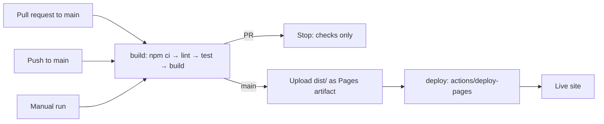
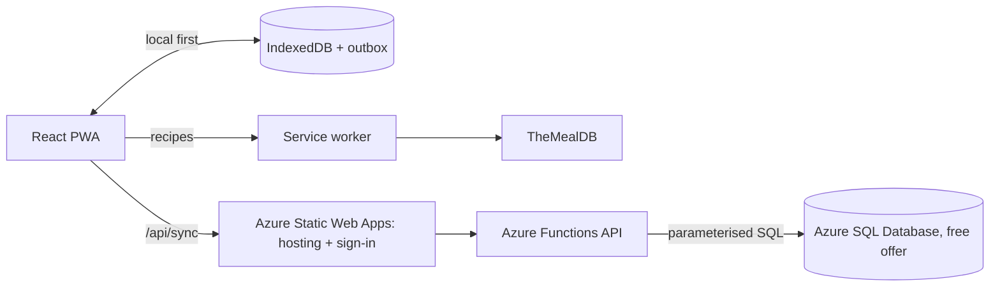

# 🥕 FridgeSaver

Cook what's already in your fridge and waste less food. A React prototype built on the free
[TheMealDB](https://www.themealdb.com/api.php) API (public test key `1`, no signup, nothing secret in the bundle).

## Screens

| Route | Screen | What it does |
|---|---|---|
| `#/fridge` | **My Fridge** | Add ingredients (autocomplete from `list.php?i=list`) with use-by dates. Items are sorted by expiry and badged *Use now / Use soon / Fresh / Expired*. |
| `#/matches` | **Recipe Matches** | Recipes ranked by how many fridge items they use, with expiring items weighted higher. |
| `#/matches/:mealId` | Recipe modal | Used vs missing ingredients, instructions as a tickable step checklist (original text unchanged, one click away), and an **I cooked this** button that logs the meal and removes the used items. |
| `#/saved` | **Saved from Waste** | Stat tiles, a Recharts bar chart of items rescued per day/week, most-rescued items and the cooking log. |

## The matching algorithm (`src/lib/matching.js`)

The free tier of TheMealDB can only filter by **one** ingredient, so multi-ingredient matching is done client-side:

1. **Fan out**: call `filter.php?i=<item>` once per fridge item, in parallel (`MatchesPage.jsx`).
2. **Merge and count**: build a `Map` keyed by `idMeal` and record which fridge items each recipe matched (`rankRecipes`).
3. **Weight by expiry**: each matched item adds a weight: use now (≤2 days) = 3, use soon (3–5 days) = 2, expired = 2, fresh = 1 (`src/lib/expiry.js`). Sort by score, then match count, then name.
4. **Fetch details for the top few only**: `lookup.php?i=` runs for the top 6 recipes, to show the "missing" count and keep API calls low.

Edge cases handled:
- An empty search returns `{ "meals": null }`, not an error, so it's treated as `[]`, with a friendly message when nothing matches.
- If no recipe uses more than one item, a **"closest matches"** notice is shown.
- Every response is cached in `localStorage` for 24 hours, because the shared test key may be rate-limited.
- If TheMealDB can't be reached (offline, CORS, rate limit), the app falls back to a small **offline sample** dataset (`src/data/sampleMeals.js`) and shows a banner.

## Tech

React 19 + Vite, React-Bootstrap, React Router (`HashRouter` for GitHub Pages), Recharts, date-fns, react-hot-toast. State lives in `FridgeContext` and persists to `localStorage` (`fs-fridge`, `fs-log`).

```
src/
  api/mealdb.js          TheMealDB calls + cache + offline fallback
  lib/expiry.js          days-left, status buckets, weights
  lib/matching.js        rankRecipes, splitIngredients (pure, unit-tested)
  context/FridgeContext  fridge items + cooking log
  pages/                 FridgePage, MatchesPage, SavedPage
  components/RecipeModal
```

## Run it

```bash
npm install
npm run dev      # http://localhost:5173
npm test         # unit tests for the matching logic
npm run build    # static build in dist/ (relative base, ready for GitHub Pages)
```

## Deployment (GitHub Pages)

Live site: **https://prakgov.github.io/RescueRecipeBuilder/**

`.github/workflows/deploy.yml` runs on GitHub Actions:



- Pull requests are linted, tested and built, but never deployed.
- A push to `main` (for example, merging a PR) publishes the new build.
- The build uses relative asset paths (`base: './'`) and `HashRouter`, so it works under the `/RescueRecipeBuilder/` sub-path.

One-time setup (repo owner): **Settings → Pages → Build and deployment → Source: GitHub Actions**.

## Notes

- No CO₂ or money-saved claims are made. The app only counts ingredients you actually used.
- TheMealDB has a small curated recipe set (~300), so some fridges will get few matches.

## Roadmap: full-stack FridgeSaver

> **Planned work, not yet built.** This roadmap is for after the course project and is not part of the course submission.

The goal is an installable app that works offline and keeps a signed-in user's fridge and cooking log in sync across devices, while staying on free cloud tiers.



| Phase | Planned features |
|---|---|
| **1. Installable PWA** | Web app manifest and icons; service worker (Workbox via `vite-plugin-pwa`) so the app opens offline; cached TheMealDB responses and images; "new version available" prompt; offline indicator. Can stay on GitHub Pages. |
| **2. Backend** | Move hosting to Azure Static Web Apps (Free plan); Azure Functions API in `api/` using `mssql`; Azure SQL Database on the free offer with tables for users, fridge items and the cooking log; SQL migrations in `db/migrations/`; CI deploys the app and API with preview environments for pull requests. |
| **3. Sign-in and sync** | Built-in sign-in (GitHub or Microsoft); local-first storage in IndexedDB with an outbox of pending changes; one `POST /api/sync` round trip to push and pull changes (last write wins per record); import existing local data on first sign-in; anonymous use keeps working locally. |
| **4. Hardening** | API and sync unit tests (including that every query is scoped to the signed-in user); retry with backoff while the database wakes from auto-pause; budget alert and "pause when the free allowance is used up"; setup guide. |

Key constraints:
- **No database credentials in the browser.** The connection string stays in server-side app settings; the browser only talks to `/api`.
- **Free tiers.** Azure SQL's free offer gives each database 100,000 vCore seconds of compute and 32 GB of data per month and auto-pauses when idle, so the app never waits on the database: it saves locally first and syncs in the background.
- **Not using Static Web Apps "database connections".** That built-in feature has been retired, so the API is our own Azure Functions code.
