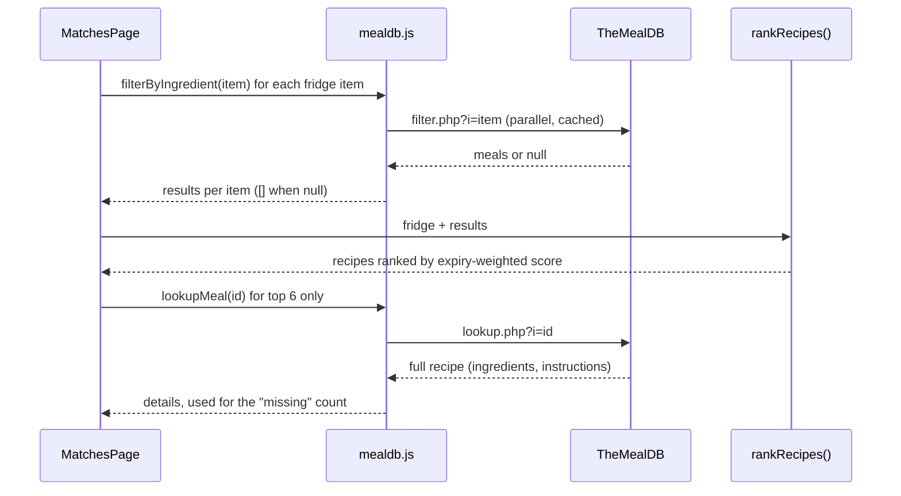
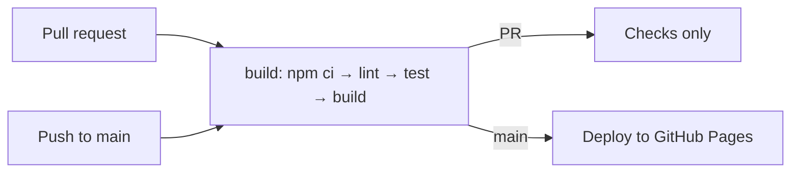
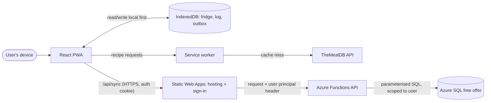
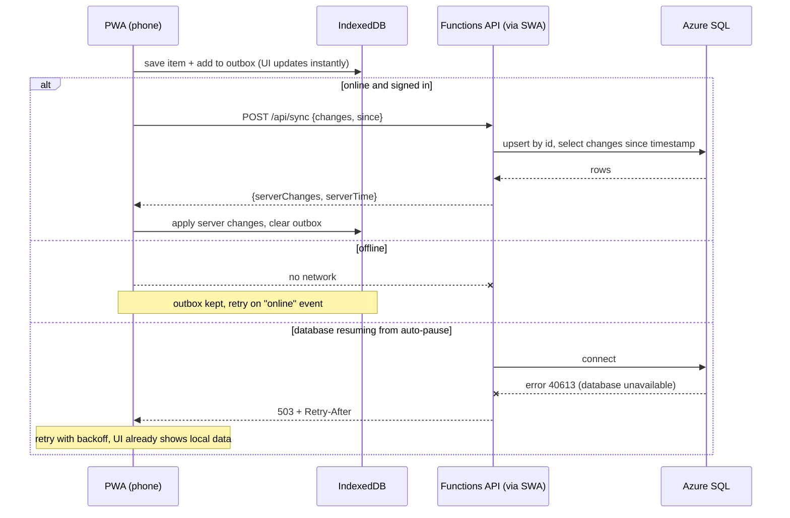

# FridgeSaver architecture

This document describes how FridgeSaver works **today** (the course prototype) and the **planned** full-stack version (an installable PWA with cloud sync on Azure SQL).

> The planned architecture is future work. It is not built yet and is not part of the course submission.

## Contents

- [At a glance](#at-a-glance)
- [Current architecture](#current-architecture)
  - [Components](#components)
  - [Structure and data flow](#structure-and-data-flow)
  - [Recipe matching](#recipe-matching)
  - [Data stored in the browser](#data-stored-in-the-browser)
  - [Build and deployment](#build-and-deployment)
- [Planned architecture](#planned-architecture)
  - [Goal and scope](#goal-and-scope)
  - [Planned components](#planned-components)
  - [Planned structure and data flow](#planned-structure-and-data-flow)
  - [Sync: key interactions](#sync-key-interactions)
  - [API](#api)
  - [Database schema](#database-schema)
  - [File-level change plan](#file-level-change-plan)
  - [Delivery phases](#delivery-phases)
  - [Risks and open questions](#risks-and-open-questions)
- [Changelog](#changelog)

## At a glance

| | Current (prototype) | Planned (full stack) |
|---|---|---|
| App | React single-page app | Same app, installable as a PWA, opens offline |
| Data | `localStorage` on one device | IndexedDB on each device, synced to Azure SQL |
| Users | Anonymous, single device | Optional sign-in (GitHub or Microsoft), many devices |
| Server | None (static files only) | Azure Functions API |
| Hosting | GitHub Pages | Azure Static Web Apps (Free plan) |
| Recipes | TheMealDB, called from the browser | Unchanged, cached by the service worker |
| Cost | $0 | $0 on free tiers (Azure SQL free offer + Static Web Apps Free) |

## Current architecture

FridgeSaver is a static React app. Everything runs in the browser: there is no server or database of our own. Recipes come from the free [TheMealDB](https://www.themealdb.com/api.php) API using its public test key, so nothing secret ships in the bundle.

### Components

| Component | File(s) | Responsibility |
|---|---|---|
| Pages | `src/pages/FridgePage.jsx`, `MatchesPage.jsx`, `SavedPage.jsx` | The three screens: My Fridge, Recipe Matches, Saved from Waste |
| Recipe modal | `src/components/RecipeModal.jsx`, `InstructionChecklist.jsx` | Used/missing ingredients, step checklist, "I cooked this" |
| State | `src/context/FridgeContext.jsx` | Fridge items and cooking log, saved to `localStorage` |
| TheMealDB client | `src/api/mealdb.js` | API calls, 24-hour response cache, offline sample fallback |
| Pure logic | `src/lib/matching.js`, `expiry.js`, `instructions.js` | Ranking, expiry buckets, instruction splitting (unit-tested) |
| Sample data | `src/data/sampleMeals.js` | Small offline recipe set used when the API can't be reached |

### Structure and data flow

The pages read and write state through `FridgeContext`, which persists it in `localStorage`. Recipe data goes through one client module that caches responses and falls back to sample data when TheMealDB can't be reached.

### Recipe matching

TheMealDB's free tier can only filter by **one** ingredient, so FridgeSaver merges results itself:

1. Call `filter.php?i=<item>` once per fridge item, in parallel.
2. Merge the results by recipe ID and count which fridge items each recipe uses.
3. Weight each matched item by expiry (use now = 3, use soon or expired = 2, fresh = 1) and sort by score.
4. Fetch full details (`lookup.php`) for the top 6 recipes only, to keep API calls low.

### Data stored in the browser

| `localStorage` key | Shape | Written by |
|---|---|---|
| `fs-fridge` | `[{ id, name, expiry: "yyyy-MM-dd" \| "", addedAt }]` | `FridgeContext` |
| `fs-log` | `[{ id, date, mealId, mealName, thumb, items: [{ name, status }] }]` | `FridgeContext` |
| `fs-cache:<path>` | `{ t: timestamp, v: response }` | `mealdb.js` (24-hour cache) |

### Build and deployment

GitHub Actions (`.github/workflows/deploy.yml`) lints, tests and builds every pull request into `main`. Each push to `main` publishes the build to GitHub Pages. The build uses relative asset paths and `HashRouter`, so it works under the `/RescueRecipeBuilder/` sub-path.

## Planned architecture

### Goal and scope

**Goals**
- Make FridgeSaver an installable Progressive Web App (PWA) that opens and works offline.
- Let a signed-in user's fridge and cooking log sync across devices, stored in an Azure SQL Database.
- Stay at $0 on the Azure SQL free offer and the Static Web Apps Free plan (or within Azure for Students credit).

**Non-goals**
- Storing TheMealDB recipes in our database (we keep calling TheMealDB directly).
- Sharing fridges between users, push notifications, native app stores.

**Constraints**
- **No database credentials in the browser.** The current site is static, so a server-side API is required between the app and the database.
- **Azure SQL free offer:** each database gets 100,000 vCore seconds of compute and 32 GB of data per month. It auto-pauses when idle and can be set to pause (instead of billing) when the monthly allowance runs out.
- **Static Web Apps Free plan:** managed Azure Functions included, built-in sign-in (GitHub, Microsoft), 100 GB bandwidth per month, no SLA.

### Planned components

| Component | Responsibility | Owns (data/state) |
|---|---|---|
| React app (PWA) | UI; reads and writes local state first | Fridge, log and outbox in IndexedDB |
| Service worker (Workbox via `vite-plugin-pwa`) | Precache the app shell; cache TheMealDB responses and images; start offline | Cache Storage |
| Sync engine (in the app) | Push queued changes, pull server changes, retry with backoff | Outbox queue, `lastSyncedAt` |
| Azure Static Web Apps (Free) | Host the static build, route `/api/*` to Functions, built-in sign-in | Sign-in session cookie |
| Azure Functions API (managed, Node) | Check identity, validate input, run parameterised SQL | Nothing (stateless) |
| Azure SQL Database (free offer, serverless) | Durable store, scoped per user | `users`, `fridge_items`, `cook_log`, `cook_log_items` |
| TheMealDB | Recipe search and details (unchanged) | Recipes |

### Planned structure and data flow

The app saves to IndexedDB first, so it stays fast and works offline. A sync engine sends queued changes to `/api/sync` when the user is online and signed in. Static Web Apps handles sign-in and passes the verified user to the Functions API, which is the only part that talks to the database.

### Sync: key interactions

The happy path is: add an item, sync, and a second device pulls the change. The two failure paths are being offline and the database waking up from auto-pause. In both, the user keeps working with local data.

### API

All routes are under `/api` and require sign-in. The user ID comes only from the `x-ms-client-principal` header that Static Web Apps sets, never from the request body.

| Route | Purpose | Shape |
|---|---|---|
| `GET /.auth/me` | Built-in: who is signed in | `{ clientPrincipal }` |
| `POST /api/sync` | Push local changes and pull server changes in one round trip (fewer database wake-ups, so less free compute used) | Request `{ since, changes: [{ table, id, op: "upsert" \| "delete", data, updatedAt }] }` → response `{ serverTime, changes: [...] }` |
| `POST /api/import` | One-time upload of existing local data on first sign-in | `{ fridge: [...], log: [...] }` |

**Conflict rule:** last write wins on `updatedAt`, per record. This is good enough for one person on a few devices.

**Config:** `SQL_CONNECTION_STRING` is a Static Web Apps application setting (server-side only). `staticwebapp.config.json` requires the `authenticated` role for `/api/*`.

### Database schema

Planned in `db/migrations/001_init.sql`:

| Table | Columns | Notes |
|---|---|---|
| `users` | `id NVARCHAR(128) PK`, `provider`, `display_name`, `created_at` | `id` = Static Web Apps `userId` |
| `fridge_items` | `id UNIQUEIDENTIFIER PK`, `user_id FK`, `name NVARCHAR(100)`, `expiry DATE NULL`, `added_at`, `updated_at`, `deleted_at NULL` | Client-generated ID; soft delete so deletes sync |
| `cook_log` | `id UNIQUEIDENTIFIER PK`, `user_id FK`, `meal_id NVARCHAR(20)`, `meal_name`, `thumb_url`, `cooked_at`, `updated_at`, `deleted_at NULL` | |
| `cook_log_items` | `log_id FK`, `position`, `name`, `status` | PK `(log_id, position)` |

Indexes: `(user_id, updated_at)` on `fridge_items` and `cook_log`, for "changes since" pulls.

### File-level change plan

| Phase | Files | Change |
|---|---|---|
| 1. PWA | `vite.config.js`, `package.json` | Add `vite-plugin-pwa`: manifest, Workbox precache, runtime caching (TheMealDB JSON: stale-while-revalidate; images: cache-first with expiry) |
| | `public/icons/*`, `index.html` | App icons (192, 512, maskable), `theme-color`, Apple touch icon |
| | `src/components/UpdatePrompt.jsx`, `App.jsx` | "New version available" prompt; offline indicator |
| 2. Backend | `api/` (`host.json`, `src/functions/sync.js`, `src/functions/import.js`, `src/db.js`, `src/auth.js`) | Azure Functions (Node) using `mssql` with a connection pool, parameterised queries, input validation, 40613 retry |
| | `db/migrations/001_init.sql` | Schema above |
| | `staticwebapp.config.json` | Route rules, auth, navigation fallback |
| | `.github/workflows/azure-static-web-apps.yml` | Replaces `deploy.yml`: build, test, deploy the app and API; preview environments for pull requests |
| 3. Sync | `src/sync/store.js` (IndexedDB via `idb`), `src/sync/outbox.js`, `src/sync/engine.js` | Local-first store, outbox, push/pull, backoff, `online` listener |
| | `src/context/FridgeContext.jsx` | Read and write through the store; add `updatedAt`/`deletedAt`; real UUID fallback |
| | `src/components/AccountMenu.jsx` | Sign in/out, sync status, "import my local data" |
| 4. Hardening | `api/**/*.test.js`, `src/sync/*.test.js` | Tests for user scoping, validation and merge rules |

### Delivery phases

| Phase | Outcome | Rough effort | Azure needed? |
|---|---|---|---|
| 1. PWA | Installable, works offline, still on GitHub Pages | ~1 day | No |
| 2. Backend | Static Web Apps + Functions + SQL deployed, empty API working | 2–3 days | Yes |
| 3. Sync | Sign in, data syncs across devices, offline edits queue | 3–4 days | Yes |
| 4. Hardening | Tests, docs, cost alerts | 1–2 days | Yes |

Each phase is shippable on its own. Anonymous users keep today's local-only behaviour throughout.

### Risks and open questions

- **Database wake-up delay:** the free serverless database auto-pauses when idle, so the first request can take tens of seconds or fail with error 40613. → The local-first UI never waits on it; the API retries with backoff; `/api/sync` batches changes.
- **Free compute running out:** 100,000 vCore seconds per month. → Set "auto-pause until next month" instead of continuing with charges; add a budget alert; don't leave query tools connected (they keep the database awake).
- **Database firewall:** managed Functions don't have a fixed outbound IP. → Enable "Allow Azure services and resources to access this server", use a strong generated SQL password kept server-side. Managed identity needs a separately deployed Functions app (more setup), to be decided.
- **Data leaking between users:** → every query filters on `user_id` from the trusted principal header, and unit tests check this for each route.
- **Retired feature:** Static Web Apps "database connections" (built-in Data API builder) has been retired. → Use our own Functions API instead.
- **Open questions:** Azure for Students or a free Azure account; when to move hosting off GitHub Pages (the URL changes to `*.azurestaticapps.net`).

## Changelog

- 2026-11-05: created; documents the current prototype and the planned full-stack design.
