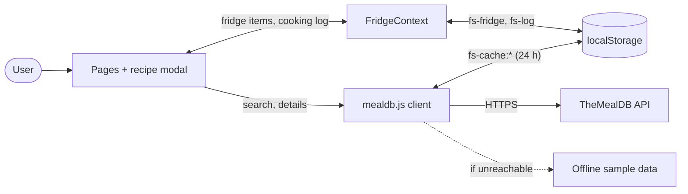
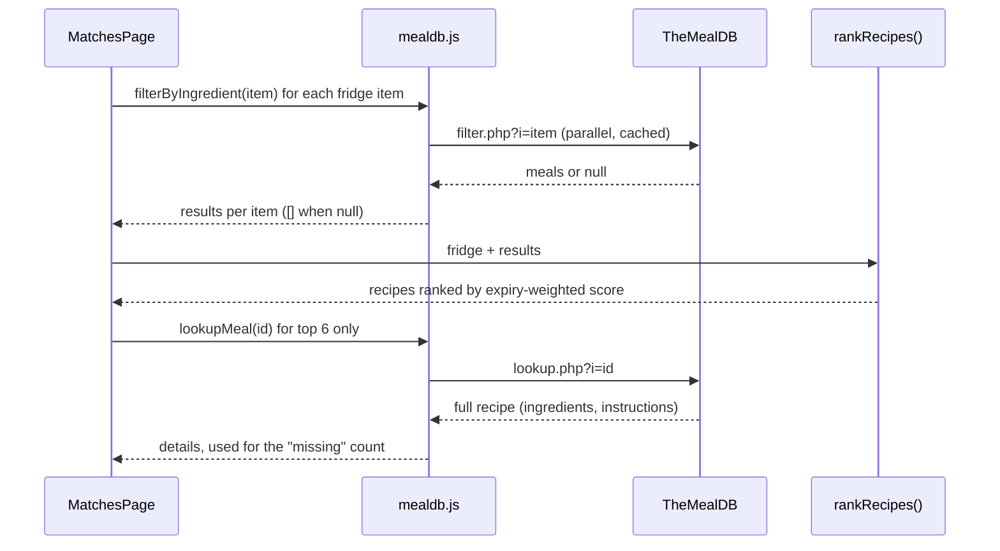
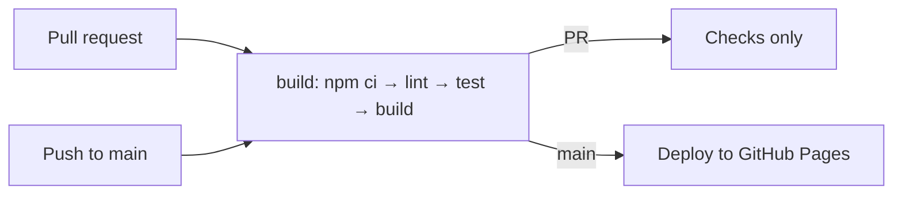

# FridgeSaver architecture

This document describes how FridgeSaver works **today** (the course prototype) and gives a short overview of the **planned** full-stack version (an installable PWA with cloud sync on Azure SQL). The full planned design is in [DESIGN.md](DESIGN.md).

> The planned architecture is future work. It is not built yet and is not part of the course submission.

## Contents

- [At a glance](#at-a-glance)
- [Current architecture](#current-architecture)
  - [Components](#components)
  - [Structure and data flow](#structure-and-data-flow)
  - [Recipe matching](#recipe-matching)
  - [Data stored in the browser](#data-stored-in-the-browser)
  - [Build and deployment](#build-and-deployment)
- [Planned architecture](#planned-architecture) (overview; full design in [DESIGN.md](DESIGN.md))
- [Changelog](#changelog)

## At a glance

| | Current (prototype) | Planned (full stack) |
|---|---|---|
| App | React single-page app | Same app, installable as a PWA, opens offline |
| Data | `localStorage` on one device | IndexedDB on each device, synced to Azure SQL |
| Users | Anonymous, single device | Optional sign-in (GitHub or Microsoft), many devices |
| Server | None (static files only) | Azure Functions API |
| Hosting | GitHub Pages | Azure Static Web Apps (Free plan) |
| Recipes | TheMealDB, called from the browser | Unchanged, cached by the service worker |
| Cost | $0 | $0 on free tiers (Azure SQL free offer + Static Web Apps Free) |

## Current architecture

FridgeSaver is a static React app. Everything runs in the browser: there is no server or database of our own. Recipes come from the free [TheMealDB](https://www.themealdb.com/api.php) API using its public test key, so nothing secret ships in the bundle.

### Components

| Component | File(s) | Responsibility |
|---|---|---|
| Pages | `src/pages/FridgePage.jsx`, `MatchesPage.jsx`, `SavedPage.jsx` | The three screens: My Fridge, Recipe Matches, Saved from Waste |
| Recipe modal | `src/components/RecipeModal.jsx`, `InstructionChecklist.jsx` | Used/missing ingredients, step checklist, "I cooked this" |
| State | `src/context/FridgeContext.jsx` | Fridge items and cooking log, saved to `localStorage` |
| TheMealDB client | `src/api/mealdb.js` | API calls, 24-hour response cache, offline sample fallback |
| Pure logic | `src/lib/matching.js`, `expiry.js`, `instructions.js` | Ranking, expiry buckets, instruction splitting (unit-tested) |
| Sample data | `src/data/sampleMeals.js` | Small offline recipe set used when the API can't be reached |

### Structure and data flow

The pages read and write state through `FridgeContext`, which persists it in `localStorage`. Recipe data goes through one client module that caches responses and falls back to sample data when TheMealDB can't be reached.

### Recipe matching

TheMealDB's free tier can only filter by **one** ingredient, so FridgeSaver merges results itself:

1. Call `filter.php?i=<item>` once per fridge item, in parallel.
2. Merge the results by recipe ID and count which fridge items each recipe uses.
3. Weight each matched item by expiry (use now = 3, use soon or expired = 2, fresh = 1) and sort by score.
4. Fetch full details (`lookup.php`) for the top 6 recipes only, to keep API calls low.

### Data stored in the browser

| `localStorage` key | Shape | Written by |
|---|---|---|
| `fs-fridge` | `[{ id, name, expiry: "yyyy-MM-dd" \| "", addedAt }]` | `FridgeContext` |
| `fs-log` | `[{ id, date, mealId, mealName, thumb, items: [{ name, status }] }]` | `FridgeContext` |
| `fs-cache:<path>` | `{ t: timestamp, v: response }` | `mealdb.js` (24-hour cache) |

### Build and deployment

GitHub Actions (`.github/workflows/deploy.yml`) lints, tests and builds every pull request into `main`. Each push to `main` publishes the build to GitHub Pages. The build uses relative asset paths and `HashRouter`, so it works under the `/RescueRecipeBuilder/` sub-path.

## Planned architecture

> Planned work, not yet built, and not part of the course submission. The full high-level design is in **[DESIGN.md](DESIGN.md)**.

The plan turns FridgeSaver into an installable PWA that works offline and syncs a signed-in user's fridge and cooking log across devices, on free Azure tiers.

- **Local first:** the app saves to IndexedDB on the device and queues changes in an outbox, so it never waits on the network or the database.
- **A small API in between:** the browser can't hold database credentials, so an Azure Functions API (hosted with the app on Azure Static Web Apps, which also handles sign-in) is the only part that talks to the database.
- **Free-tier database:** Azure SQL Database on the free offer, which auto-pauses when idle; one `/api/sync` round trip keeps wake-ups and compute use low.

| Phase | Outcome |
|---|---|
| 1. PWA | Installable, works offline, still on GitHub Pages |
| 2. Backend | Static Web Apps + Functions + Azure SQL deployed |
| 3. Sync | Sign in, data syncs across devices, offline edits queue |
| 4. Hardening | Tests, docs, cost alerts |

See [DESIGN.md](DESIGN.md) for the components, sync sequence (including offline and database wake-up), API, database schema, file-level change plan, effort estimates and risks.

## Changelog

- 2026-11-05: created; documents the current prototype and the planned full-stack design.
- 2026-11-05: moved the full planned design to [DESIGN.md](DESIGN.md); kept a short overview here.
