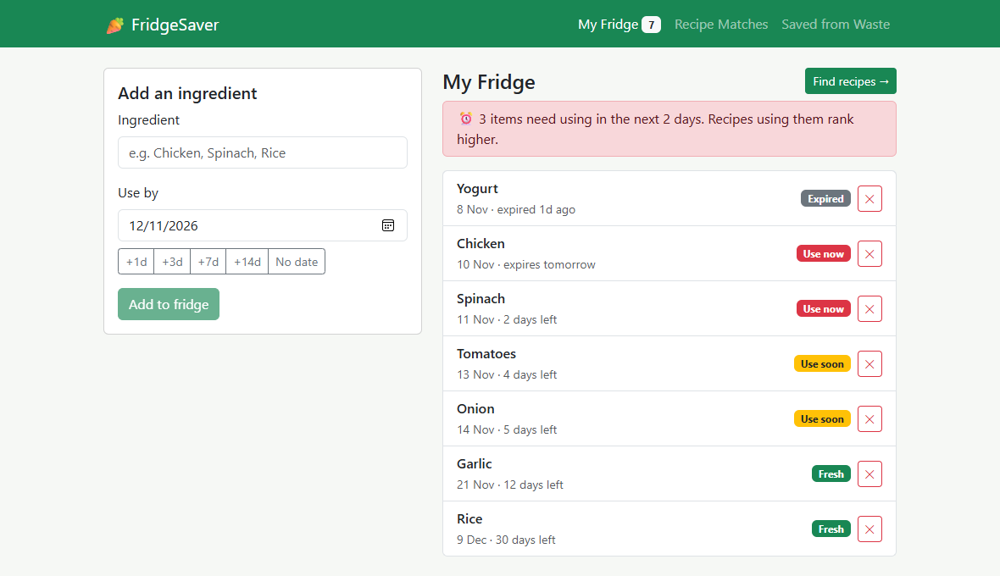
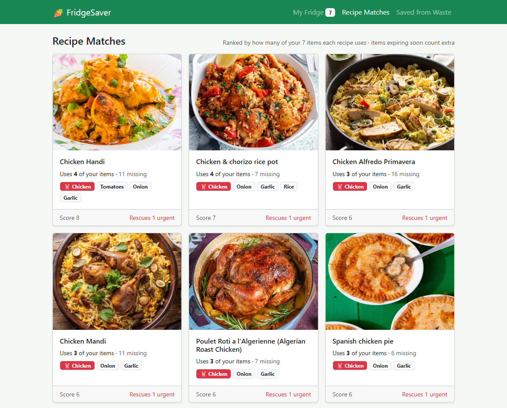
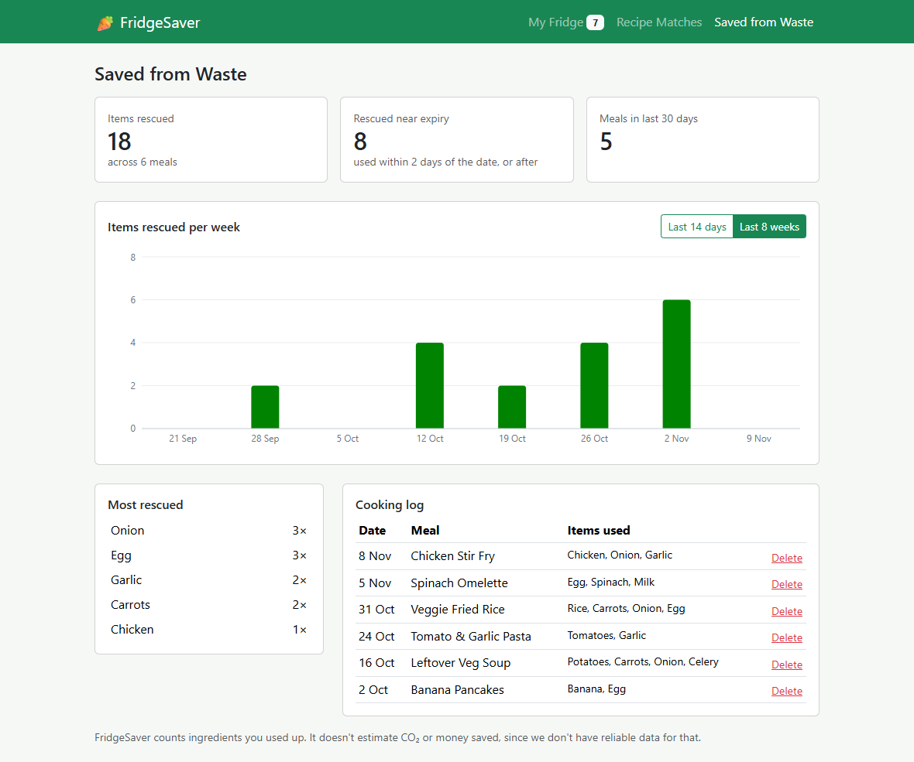
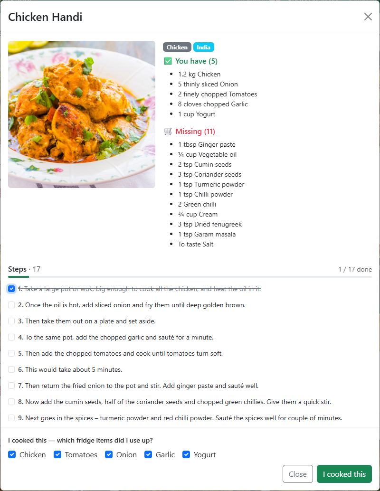

# Web Programming Final Project: FridgeSaver
*Cook what is already in your fridge and waste less food.*

Prakirth Govardhanam | November 2026 | Repository: [RescueRecipeBuilder](https://github.com/prakgov/RescueRecipeBuilder/)

## Table of contents
- [1. Project description](#1-project-description)
- [2. Screenshots](#2-screenshots)
- [3. AI usage statement](#3-ai-usage-statement)
- [4. Reflection](#4-reflection)
- [Appendix: My Claude Code workflow](#appendix-my-claude-code-workflow)
- [More Technical detail](https://github.com/prakgov/RescueRecipeBuilder/blob/f39e77755c256edfb7cbb9a212b692b8e2721855/docs/TECHNICAL_OVERVIEW.md): matching algorithm, fallbacks, deployment, architecture and roadmap diagrams

## 1. Project description

- The app is a React web app for people who want to use up what is in their fridge before it becomes expired and goes into the garbage. 
- Users add ingredients with their use-by dates, and the app suggests recipes that use as many of them as possible, ranking recipes that rescue soon-to-expire items first. When a meal is cooked, it logs what was saved and charts it over time.
- API: [TheMealDB](https://www.themealdb.com/api.php) (free, keyless public test key, so nothing secret in the static bundle).
- Libraries and their jobs:

| Library | Function |
|---------|----------|
| React 19 + Vite | UI and build |
| React-Bootstrap | Layout and components |
| React Router (HashRouter) | Routes that work on GitHub Pages |
| Recharts | The "items rescued" bar chart |
| date-fns | Days-left and weekly/daily buckets |
| react-hot-toast | Notifications |
| Vitest | Unit tests |

- Data stays in the browser (localStorage) and no account is needed.

- **Repository:** https://github.com/prakgov/RescueRecipeBuilder
- **Live app:** https://prakgov.github.io/RescueRecipeBuilder/

## 2. Screenshots

Screenshots were taken using sample data.

- Screen 1 - **My Fridge**: ingredients sorted by use-by date, with status badges.

- Screen 2 - **Recipe Matches**: recipes ranked by how many fridge items they use, with expiring items weighted higher.

- Screen 3 - **Saved from Waste**: items rescued over time and the cooking log.

- **Feature highlight: recipe modal**: have/missing ingredients, a step checklist, and the *I cooked this* button.

## 3. AI usage statement

- I used Claude Code to plan, build features, refactor, and debug issues. **To keep its output under my control, I spent a lot of time building skills and rules that make it follow my engineering workflow (see [Appendix](#appendix-my-claude-code-workflow))**. Claude Code(Sonnet/Opus) was used roughly for 1-2 hours to complete this project and I spent roughly 2-3 hours reviewing and editing its output. Claude Code was also used to generate a draft of this report which I actively edited and modified. 
- I **used AI to** generate the initial prototype from my written plan (PR #1), build the GitHub Pages CI/CD pipeline and diagnose its first failed deploy (PR #3), implement the recipe text split into a verbatim step checklist with a unit test (PR #6), plan the full-stack PWA + Azure design and architecture docs (PR #8), fix a footer floating mid-screen after spotting it in the browser (PR #9), and run the app to capture screenshots, which exposed a possible recipe matches count bug (*'Use X of your items'*).
- I chose **not to use AI for** enabling GitHub Pages myself (repo-owner step), checking the UI in the browser (caught the footer bug), direction calls regarding open-source licensing, approving the force-push, docs layout for architecture diagrams and planned design, time estimates, and reflections since the UI, user experience, open sourcing and architectural decisions are subjective and I wanted to make those decisions myself.

## 4. Reflection

- The most challenging part was designing around an API that offered free, keyless access, so the application could be deployed and used right away. I started by focusing on the idea that I want to build something specific for myself that helps me on a daily basis. From there, I researched APIs that would allow me to build a recipe app and I found TheMealDB but it only allows filtering by one ingredient at a time. Then I had to figure out how to implement a multi-ingredient matching algorithm on the client side, which was a fun challenge. I also had to consider how to handle edge cases, such as when no recipes match the user's fridge items, and how to provide a good user experience in those situations. See [Technical Overview](https://github.com/prakgov/RescueRecipeBuilder/blob/f39e77755c256edfb7cbb9a212b692b8e2721855/docs/TECHNICAL_OVERVIEW.md) for matching algorithm. I chose TheMealDB over Spoonacular for the app to be deployed and used without any barriers.
- I opted for `localStorage` instead of a backend to keep the app simple and user-friendly, and used `HashRouter` with relative paths to ensure compatibility with GitHub Pages. I also separated pure logic into `src/lib` for easier unit testing and chose a flex sticky footer over a fixed position to improve layout responsiveness and keep it from covering the content. Additionally, I selected the AGPL license to keep the code open-sourced forever.
- With more time, I would focus on testing the application thoroughly, implementing the planned roadmap phases, including making the app an installable PWA, adding an Azure backend for data synchronization, and enabling user sign-in to sync fridge and cooking log data across devices. I would also address the recipe card vs modal count mismatch bug.
- Overall, I gained a deeper understanding of how to handle API limitations, implement client-side logic for data processing, and design a user-friendly interface that effectively helps users reduce food waste. 
- This experience reminded me of the project workflow from Software Engineering 1 and Information Systems Design courses, where I learned to break down complex problems into manageable components and iteratively build solutions while considering user experience and technical constraints.

## Appendix: My Claude Code workflow

The `SKILLS` below were dervied from my workflow as I was building with Claude Code. The global `CLAUDE.md` (not shared here) holds the rules that dicatate terms and conditions to Claude Code to work the way I do, so that its output reaches the repository through my engineering conventions.

| Skill or rule | What it enforces | Where this project shows it |
|---|---|---|
| `dev-driver-mode` | Before each issue, asks whether I drive (Claude coaches, no code) or Claude drives | Asked before each issue; I chose Claude drives for [#2](https://github.com/prakgov/RescueRecipeBuilder/issues/2), [#5](https://github.com/prakgov/RescueRecipeBuilder/issues/5), [#7](https://github.com/prakgov/RescueRecipeBuilder/issues/7) |
| `dev-git-issue-pr` | Issue with a checklist of the agreed plan, `<type>/<slug>` branches, Conventional Commits, "Area: summary" PR titles, ask before push or force-push | Issues #2, #5, #7; branches such as `ci/github-pages-deploy`, `feat/recipe-instruction-checklist`; PRs [#3](https://github.com/prakgov/RescueRecipeBuilder/pull/3)–[#10](https://github.com/prakgov/RescueRecipeBuilder/pull/10) |
| `dev-task-playbooks` | Bug, feature and refactor playbooks: reproduce first, acceptance criteria to failing tests (TDD/BDD), no behaviour change in refactors | Verbatim-split unit test for the step checklist ([PR #6](https://github.com/prakgov/RescueRecipeBuilder/pull/6)) |
| `design-hld` / `design-lld` | Mermaid high-level and component-level designs before building | Architecture and planned full-stack design with diagrams ([PR #8](https://github.com/prakgov/RescueRecipeBuilder/pull/8)) |
| `kms-session-closeout` | Session log, reflection log and PSP time row in my Obsidian vault after each session | 4 logged sessions, 2026-11-03 to 2026-11-09, with estimated vs actual hours |
| `kms-adr` | Architecture decision record when a change touches more than three files and involves a design decision | Checked at each closeout; no change has needed one yet |
| Global `CLAUDE.md` | Pair programming: explain first, agree the plan before code, small reviewable steps, ask before dependencies, pushes and history rewrites | Force-push approved explicitly once ([PR #3](https://github.com/prakgov/RescueRecipeBuilder/pull/3) era); report tooling kept out of project dependencies |
