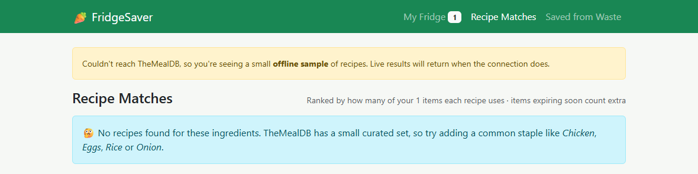
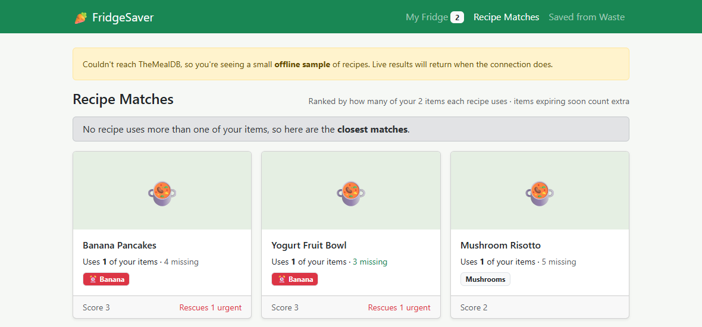
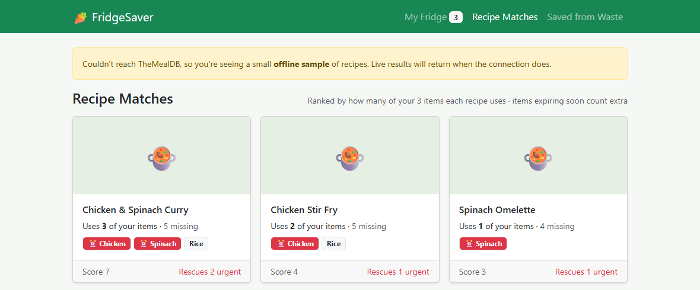
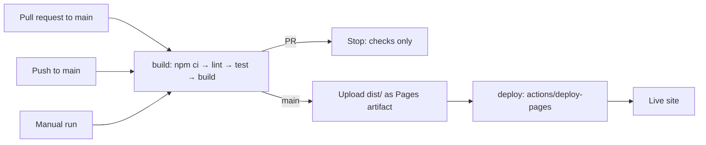
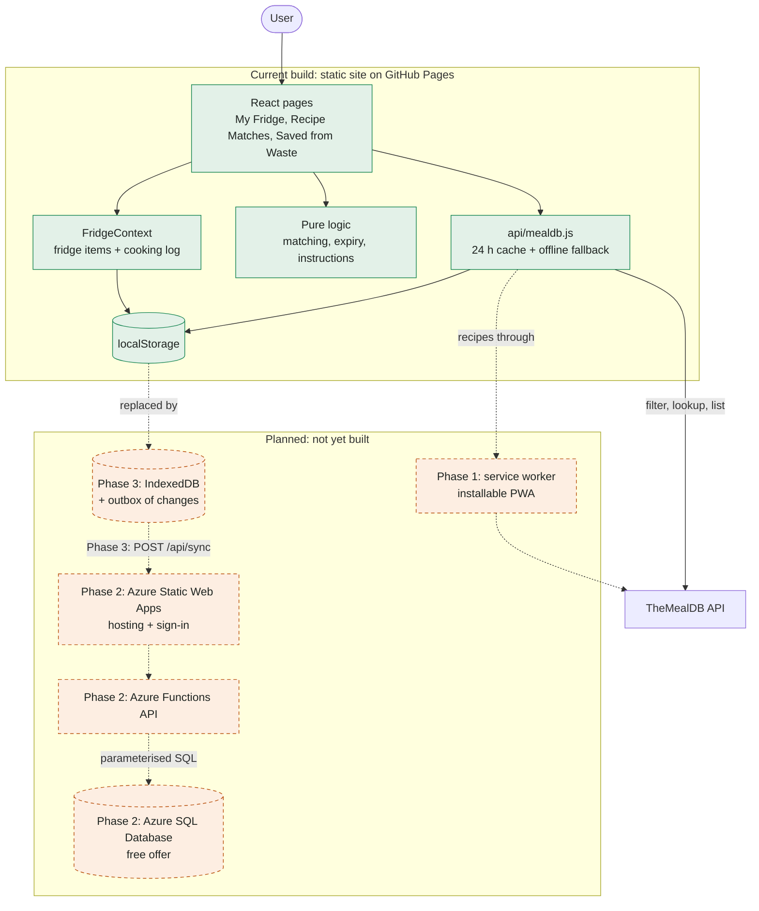

# FridgeSaver: Technical Overview

Supporting detail for the [project report](PROJECT_REPORT.md): how the app works, how it is built and deployed, and what is planned next.

> Screenshots were taken from the running app using sample fridge data and a sample cooking log.

## Honest measurement

FridgeSaver makes no CO₂ or money-saved claims. Its impact figures only count ingredients the user actually used in a meal they logged.

## Tools and Technology
- Tools:
  - GitHub: source control, issues, pull requests, CI/CD, Pages hosting
  - Visual Studio Code: editor and debugger
  - Claude Code (Sonnet/Opus): planning, coding, refactoring, debugging
  - Chrome DevTools: browser debugging and screenshots
  - Mermaid MCP server: architecture diagrams

- Tech stack:
  - React 19, Vite, React-Bootstrap, React Router (`HashRouter`), Recharts, date-fns, react-hot-toast.
  
- Application state lives in `FridgeContext` and persists to `localStorage` under `fs-fridge` and `fs-log`.

## The matching algorithm

The core engineering problem comes from an API limit: the free tier of TheMealDB can only filter by **one** ingredient. FridgeSaver therefore does multi-ingredient matching on the client, in `src/lib/matching.js`.

1. **Fan out.** Call `filter.php?i=` once per fridge item, in parallel.
2. **Merge and count.** Build a `Map` keyed by `idMeal`, recording which items each recipe matched.
3. **Weight by expiry.** Each matched item adds a weight. Sort by score, then match count, then name.
4. **Fetch details.** Run `lookup.php?i=` for the top 6 recipes only, to show the missing count.

Because full details are fetched only for the top 6, a fridge of *n* items costs at most *n* + 6 uncached API calls, however many recipes match.

**Expiry weights (`src/lib/expiry.js`)**

| Status | Days left | Weight |
|---|---|---|
| Use now | 2 or fewer | 3 |
| Use soon | 3 to 5 | 2 |
| Expired | Past use-by | 2 |
| Fresh | More than 5 | 1 |

### Edge cases handled

An empty search returns `{"meals": null}`, which is treated as an empty list with a friendly message.



If no recipe uses more than one item, a "closest matches" notice is shown.



## Resilience

The shared test key may be rate-limited, so the API layer has two defences. Every response is cached in `localStorage` for 24 hours. If TheMealDB can't be reached because of an offline connection, CORS or a rate limit, the app falls back to a small offline sample dataset and shows a banner.



## Code structure

Logic that can be tested on its own is kept in pure modules under `src/lib/`, separate from React components. Unit tests cover matching, expiry and instruction steps.

```text
src/
  api/mealdb.js          TheMealDB calls + cache + offline fallback
  lib/expiry.js          days-left, status buckets, weights
  lib/matching.js        rankRecipes, splitIngredients (pure, unit-tested)
  lib/instructions.js    splitInstructions: recipe text to checklist steps
  context/FridgeContext  fridge items + cooking log
  pages/                 FridgePage, MatchesPage, SavedPage
  components/            RecipeModal, InstructionChecklist
```

## Known limitations

TheMealDB has a small curated recipe set, so some fridges will get few matches. Fridge data also lives in a single browser until the planned sync work is built.

## Build and deployment

GitHub Actions (`.github/workflows/deploy.yml`) lints, tests and builds every change. Pull requests stop there; a push to `main` publishes the new build to GitHub Pages.



The build uses relative asset paths (`base: './'`) and `HashRouter`, so it works under the `/RescueRecipeBuilder/` sub-path.

## Current build and future plans

The full-stack work is planned for after the course project; it is not yet built and is not part of the submission. The goal is an installable, offline-capable app that syncs a signed-in user's fridge and cooking log across devices on free cloud tiers.

Green solid boxes exist today. Orange dashed boxes and dotted arrows are planned.



| Phase | Planned features |
|---|---|
| **1. Installable PWA** | Manifest and icons; Workbox service worker so the app opens offline; cached recipes and images; update prompt; offline indicator. |
| **2. Backend** | Azure Static Web Apps hosting; Azure Functions API using `mssql`; Azure SQL tables for users, fridge items and the cooking log; SQL migrations; CI with preview environments. |
| **3. Sign-in and sync** | GitHub or Microsoft sign-in; IndexedDB with an outbox of pending changes; one `POST /api/sync` round trip (last write wins); first sign-in import; anonymous use stays local. |
| **4. Hardening** | API and sync tests, including that every query is scoped to the signed-in user; retry with backoff during database wake-up; budget alert; setup guide. |

## Key design constraints

- **No database credentials in the browser.** The connection string stays in server-side app settings; the browser only talks to `/api`.
- **Free tiers.** Azure SQL's free offer gives each database 100,000 vCore seconds and 32 GB of data per month and auto-pauses when idle, so the app saves locally first and syncs in the background.
- **Own API code.** The Static Web Apps "database connections" feature has been retired, so the API is custom Azure Functions code.

## License

Copyright © 2026 Prakirth Govardhanam. Free software under the GNU Affero General Public License v3 or later. Anyone running a modified version as a network service must offer its users the corresponding source code.
